# Feature map

Every feature Fox Schema ships, what it is made of, and how the pieces connect —
so a bug fix, an improvement, a test or a new sub-feature starts from the right
files, the right permission, the right tables and the tests that already guard it.

[CODE_MAP.md](CODE_MAP.md) says where code lives; this page says **what each
feature is** and **what it touches**. Plan work against the feature IDs below
(`editor.run`, `schema.compare`, …) and the `dialect.<engine>` IDs: the planning
board uses the same IDs. [feature-map.html](feature-map.html) is the same map as
an interactive page (open it in a browser), and
[the test and fix plan](plans/2026-10-25-feature-and-dialect-test-plan.md) sets
the order every feature and dialect is tested in.

Measured on `main` at `91d4165c09` (2026-10-25): 17 server feature modules,
153 HTTP routes (pinned by `packages/server/src/api/http-contract.test.ts`),
14 frontend features, 16 database engines, 28 metadata tables (31 migrations),
49 e2e specs, ~530 unit-test files. Re-measure with the commands in
[Keeping this page true](#keeping-this-page-true).

- [System](#system)
- [Feature tree](#feature-tree)
- [Feature catalog](#feature-catalog)
- [Workflows](#workflows)
- [Metadata schema](#metadata-schema)
- [Engines and capabilities](#engines-and-capabilities)
- [Tests and known gaps](#tests-and-known-gaps)
- [Planning work](#planning-work)

## System

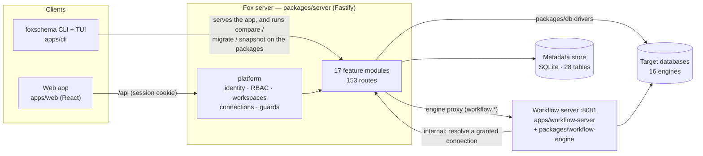

Packages import one way only (`sql ← db ← server`, `sql ← ui-shared ← web`);
[CODE_MAP.md](CODE_MAP.md#packages) has the rule and the tests that enforce it.

Every request takes the same path before a feature sees it:

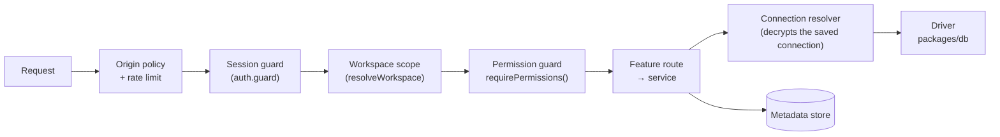

Permissions are install-wide (from the account role: code cells, Git, workflow,
admin, Install drivers, creating workspaces) or per workspace (from the member's
role there: everything about saved connections and schema). See
`packages/shared/src/permissions.ts` — `INSTALL_PERMISSIONS` and
`effectivePermissions()`.

## Feature tree

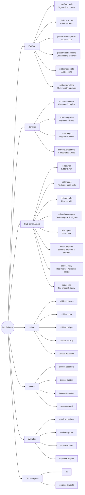

## Feature catalog

One row per feature. **UI** is where it is opened; **API** the route prefix and
count; **Code** the server feature / frontend feature / dialect module; **Perms**
the permissions it checks; **Tables** what it stores; **Tests** unit-test files
in its folders and its e2e specs (`apps/e2e/src/tests`).

### Platform

| ID | Feature and sub-features | UI | API | Code | Perms | Tables | Tests |
|---|---|---|---|---|---|---|---|
| `platform.auth` | Sign-in & accounts — password sign-in, register, first-run setup code, launch session (use Fox before creating an account), email verification, forgot / reset password, SSO (Google, Microsoft, GitHub, broker), sign out other sessions, onboarding wizard | Sign-in page, account banners | `/api/auth` (17), `/api/signup` (3) | server `auth`, `users`, `platform/identity`; web `auth` | — (public routes) | `users`, `sessions`, `auth_codes`, `user_preferences` | server 9, web 3; e2e `auth-recovery`, `smoke` |
| `platform.admin` | Administration — users (create, invite, role, activate, set password, issue code, hand over admin), role → permission matrix, one admin or several, sign-in settings (providers, mail, broker, public URL), every workspace | Profile → Access control | `/api/admin` (19) | server `admin`; web `admin` | `admin.users`, `admin.roles` | `users`, `role_permissions`, `app_settings` | server 3, web 4; e2e `admin-policy` |
| `platform.workspaces` | Workspaces — rail button and menu, create, switch, archive, settings, members and workspace roles, invites (accept / decline, 14 days), public discover / join, shared workspace scripts | Rail button under the Fox mark | `/api/workspaces` (20) | server `workspaces`, `platform/workspaces`; web `workspaces` | `workspace.members`, `workspace.settings`, `workspace.create` | `workspaces`, `workspace_members`, `workspace_invites`, `workspace_scripts` | server 4, web 2; e2e `workspaces` |
| `platform.connections` | Connections & drivers — credential manager, connection form (password / Windows / LDAP, SSL, pool, SQLite / DuckDB file picker), schema list, connection test, driver check and Install driver, cloud provider credentials | Creds (rail), connection modal | `/api/connections` (4), `/api/connection/test`, `/api/db/test`, `/api/driver` (2) | server `connections`, `platform/connections`, `internal/driver-install`; web `connections` | per workspace role; `admin.drivers` to install | `connections`, `cloud_provider_credentials` | server 1, web 1 |
| `platform.secrets` | App secrets — vault entries, cloud secret providers, resolving a secret | Creds → secrets, editor Secrets panel | `/api/app-secrets` (9) | server `admin` (app-secrets mount) | `secrets.view/create/edit/delete` | `app_secrets`, `cloud_provider_credentials` | — |
| `platform.system` | Shell, health, updates — activity rail, top toolbar, command palette, home, backend-offline banner, activity, app info, config, update check / apply, email and update settings, send feedback | App shell, Prefs | `/api/health`, `/api/config`, `/api/app-info`, `/api/activity`, `/api/updates` (2) | server `system`; web `app/shell`, `app/settings`, `feedback` | — | `app_settings` | server 1, web 2; e2e `smoke`, `lazy-loading`, `send-feedback`, `auto-error-catch` |

### Schema

| ID | Feature and sub-features | UI | API | Code | Perms | Tables | Tests |
|---|---|---|---|---|---|---|---|
| `schema.compare` | Compare & deploy — connection pair, browse bar, schema tree, object detail (DDL diff, blueprint, detail tabs), diff briefing, cross-dialect readiness, dependency and validation warnings, execute gate (missing-FK / narrowing review), deploy confirm, streamed migration progress | Compare (rail) | `/api/compare`, `/api/schema/load`, `/api/schema/list`, `/api/migration/execute` | server `compare`, `schema`, `migration`; web `compare`, `schema-diff`; sql `schema-diff`, `migrations`, `dialect` | `schema.browse`, `schema.compare`, `schema.migrate` | `migration_runs` | sql 12, web 14; e2e `compare-flow`, `execute-gate`, `schema-browse`, 14 dialect suites |
| `schema.applies` | Migration history — runs, script, results, delete | Applies (rail) | `/api/migrations` (5) | server `migration`; web `migrations` | `schema.migrate` | `migration_runs` | server 3, web 1 |
| `schema.git` | Migrations in Git — repositories (bare local copies), branches, fetch / pull / push, commit a migration, preview, applied tracking, activity | Compare → Git, Admin | `/api/git` (15) | server `git`; web `git` | `git.view`, `git.manage` | `git_repos`, `git_applied`, `git_activity`, `migration_runs.git_*` | server 4, web 1; e2e `git-migrations` |
| `schema.snapshots` | Snapshots (Lokee Weave) — capture, databases, version timeline, graph, version compare, change chart, object inspector, revert (plan → run), force-migrate (plan → run), rename a version | Snapshots (rail) | `/api/lokee` (11) | server `history`; web `lokee-weave`; sql `lokee-weave` | `compare.history`, `schema.migrate.force` | `lokee_databases`, `lokee_versions`, `lokee_version_objects`, `lokee_objects`, `lokee_latest_objects`, `lokee_shapes` | sql 15, server 3, web 14; e2e `schema-history`, `schema-revert`, `schema-version-revert-edges` |

### SQL editor and data

| ID | Feature and sub-features | UI | API | Code | Perms | Tables | Tests |
|---|---|---|---|---|---|---|---|
| `editor.run` | Editor & run — tabs (stored per workspace), Destinations, run rail (In [n], ▶, include checkbox, Safe-mode marks, copy with values), selection / caret run, Safe mode confirm (writes, DDL, no-WHERE acknowledgement, multi-table threshold), One transaction, per-dialect write classification, Format SQL+JS, clause-aware completions, column picker, shortcuts | Editor (rail) | `/api/sql/execute` | server `sql-editor` (`sql-execute.service`, `sql-page-wrap.service`); web `sql-editor`; sql `sql-text`, `sql-editor` | `editor.access`, `editor.run`, `editor.dml`, `editor.ddl`, `editor.grant` | — | server 7, web 59 (feature), sql 16; e2e `sql-editor-smoke`, `-sqlite`, `-join-typing`, `-running-state` |
| `editor.code` | FoxScript code cells — JS / TS / Node / Node-TS cells, transpile, `sql` bridge (bound params, `sql.list`, `sql.raw`), `-- @set`, Server Beam (`sql.on('source' / 'target')`), faker / lodash / date-fns, built-in samples | Editor | `/api/sql/code-cell`, `/api/sql/code-cell/transpile` | server `sql-editor` (`code-cell-*`); web `sql-editor/lib` | `editor.advanced` (install-wide) | — | e2e `sql-editor-code-cell-faker` |
| `editor.results` | Results — by credential / side by side, grid paging (rows / page, Next / Prev, seek), cell and row edit, copy and CSV export, chart, maximize, runs drawer, warnings | Editor | (with `/api/sql/execute`) | web `ResultsPanel`, `DataGrid` | `editor.datagrid.insert/update/delete` | — | e2e `sql-editor-result-edit`, `-copy-export` |
| `editor.datacompare` | Data compare & migrate — compare toggle, Source, diff cells, key columns, add / edit / delete, Sync column, apply (Transaction where the engine can roll back, stop / continue, backup snapshot), history, preview SQL, multi-target | Editor, side by side | `/api/data-migrate/execute`, `/api/data-migrations` (5) | server `data-migrate`; web `DataMigrateBar` | `editor.dml` | `data_migrate_runs` | server 4; e2e `sql-editor-compare-multi-target` |
| `editor.peek` | Data peek — Cmd/Ctrl-click to open, stacked panels, WHERE / ORDER BY / limit, paging, row editor (add / edit / clone / delete, value generators), insight tab, FK drill and referenced-by, date picker | Editor | (with `/api/sql/execute`) | web `DataPeekPanel`, `PeekRowEditor`, `usePeekGridCrud` | `editor.datagrid.*` | — | e2e `sql-editor-peek-row-form`, `-peek-stacking` |
| `editor.explorer` | Schema explorer & blueprint — connection picker, object tree, insert names, object source script, table blueprint (create / edit), New table, Install driver banner | Editor sidebar | `/api/schema/load` | web `SqlSchemaExplorer`, `TableBlueprintModal`, `MissingDriverBanner` | `editor.sidebar.schema`, `schema.browse` | — | e2e `sql-editor-blueprint`, `-column-picker` |
| `editor.library` | Bookmarks, samples, recent, variables & secrets, shared workspace scripts | Editor sidebar | `/api/workspaces/scripts` (3) | web `SqlBookmarksPanel`, `SqlVariablesPanel`, `SqlSecretsPanel` | `editor.variables.*`, `editor.sidebar.*` | `workspace_scripts` | (in `editor.run` counts) |
| `editor.files` | File import & query — chunked upload sessions, column detection, import into a table, query an uploaded CSV / JSON / NDJSON file, capacity, database-file picker | Editor → Files, Utils → Query files | `/api/files` (11) | server `files` (parse worker pool) | `editor.run` | — | server 9 |

### Utilities and Access

| ID | Feature and sub-features | UI | API | Code | Perms | Tables | Tests |
|---|---|---|---|---|---|---|---|
| `utilities.indexes` | Index management — fragmentation (custom probe is one read-only SELECT), batch, rebuild / reorg / optimize SQL (Db2: every index on the table), drop | Utils (rail) | `/api/schema/index-fragmentation`, `-batch` | server `access` (`index-fragmentation.service`); sql `utilities` | `utility.access`, `utility.index.drop` | — | sql 7; e2e `sql-editor-utilities`, `-utilities-dialects` |
| `utilities.clone` | Clone table | Utils | (editor execute) | web `CloneTableModal` | `utility.access`, `editor.ddl` | — | (utilities e2e) |
| `utilities.insights` | Server insights, table insight, query files | Utils | `/api/schema/dba-utility`, `/api/schema/table-insight` | server `access` (`dba-utilities.service`) | `utility.access` | — | (utilities e2e) |
| `utilities.backup` | Backup & Restore — per-engine command builders, server-side SQL backup after confirmation, recorded backups, saved defaults | Utils | `/api/backup-settings` (2) | server `backup`; sql `providers/*/*.backup.ts` | `utility.access` | `backup_settings` | server 2; e2e `backup-restore-ui`, `backup-commands-dialects` |
| `utilities.dbaccess` | DB users & grants (Database Access modal) | Utils | `/api/schema/db-access` | server `access` (`db-access.service`) | `utility.access`, `editor.grant` | — | e2e `database-access-dialects` |
| `access.accounts` | Database accounts — create, rename, drop, passwords (per-engine DDL) | Access (rail) | `/api/schema/db-access` | web `access` (`UserManagement`); sql `access`, `providers/*/*.user-sql.ts` | `access.access`, `access.users` | — | sql 13, web 12 |
| `access.builder` | Permission builder — intent → GRANT / REVOKE, grants stage, object picker; executes and stops at the first failure | Access | `/api/schema/db-access` | web `AccessPermissionPanel`, `AccessGrantsStage`; sql `providers/*/*.access-sql.ts` | `access.builder`, `editor.grant` | — | e2e `access-assistant-sqlite`, `access-assistant-dialects` |
| `access.inspector` | Inspector and Insight (privilege compare) | Access | `/api/schema/db-access` | web `PermissionInspector`, `PermissionDiff`, `PermissionMatrix` | `access.inspector`, `access.diff` | — | (access tests) |
| `access.report` | Access report | Access | `/api/schema/db-access` | web `AccessReport` | `access.report` | — | (access tests) |

### Workflow, CLI and engines

| ID | Feature and sub-features | UI | API | Code | Perms | Tables | Tests |
|---|---|---|---|---|---|---|---|
| `workflow.designer` | Designer — workflows list, canvas (pipes and edges), palette, inspector, triggers, SQL / script / HTTP / delimited editors, dependencies | Workflow (rail) | engine proxy under `/api/workflow` | web `workflow`; `packages/workflow-engine/src/definitions.ts` | `workflow.access`, `workflow.design` | engine's own store | web 12; e2e `workflow-designer-roundtrip` |
| `workflow.pipes` | Pipes — db (SQL on every dialect, Postgres / MySQL sources), http (request, multi-http, transform, sink, cookies), notify (email, SMS, SMTP), control (loop, split, merge, goto, human gate, sub-workflow), utility (CSV, delimited, JSON, script, text, transforms, verify, files), trigger | Designer palette | (engine) | `packages/workflow-engine/src/pipes/*` | `workflow.design` | — | workflow-engine 87 |
| `workflow.runs` | Runs — execution panel, cancel a live run, answer a human gate, variables, credentials | Workflow | engine proxy | web `RunsPanel`, `ExecutionPanel`, `VariablesPanel`, `CredentialsPanel` | `workflow.run` | engine's own store | (workflow tests) |
| `workflow.engine` | Engine control plane — settings and health, saved-connection grants, internal resolve / engine-config routes (token-guarded) | Workflow → Engine | `/api/workflow` (5), `/api/workflow-internal` (2) | server `workflow`; `apps/workflow-server`; `packages/workflow-contract` | `workflow.admin` | `workflow_settings`, `workflow_connection_grants` | server 6, workflow-server 19; e2e `workflow-smoke` |
| `cli` | `foxschema` — setup, open, compare, migrate, snapshot, history, connections, drivers (e.g. `drivers install db2`), doctor, search, shortcut, reset-password; TUI screens | Terminal | (packages + local server) | `apps/cli` | — | metadata store | cli 25 |
| `engines.dialects` | 16 engines: SQL generation, compare, splitting, type mapping (`packages/sql/src/providers`) and drivers (`packages/db/src/providers`) | — | — | see [Engines and capabilities](#engines-and-capabilities) | — | — | sql 86, db 24; 14 dialect e2e suites |

## Workflows

### Compare → deploy

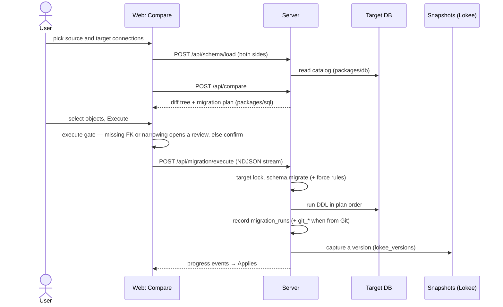

### SQL editor — Run

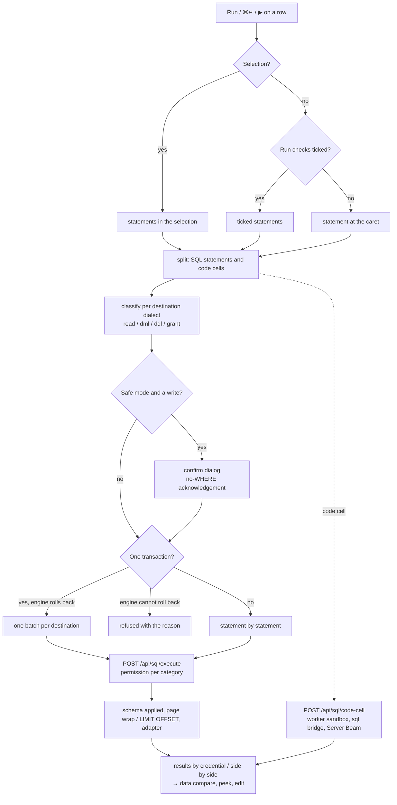

### Data compare → data migrate

```mermaid
flowchart LR
  A[Same SELECT on ≥2 destinations] --> B[Side by side + Compare data]
  B --> C[align rows by key columns]
  C --> D[add / edit / delete per target<br/>Sync column picks rows]
  D --> E[Preview SQL]
  E --> F{Safe mode}
  F -- confirm --> G[POST /api/data-migrations/start]
  G --> H[backup snapshot of affected rows]
  H --> I[POST /api/data-migrate/execute<br/>Transaction only where it can roll back<br/>stop or continue on error]
  I --> J[POST /api/data-migrations/:id/finish<br/>data_migrate_runs]
  J --> K[History: restore from snapshot]
```

### Snapshots — capture, compare, revert

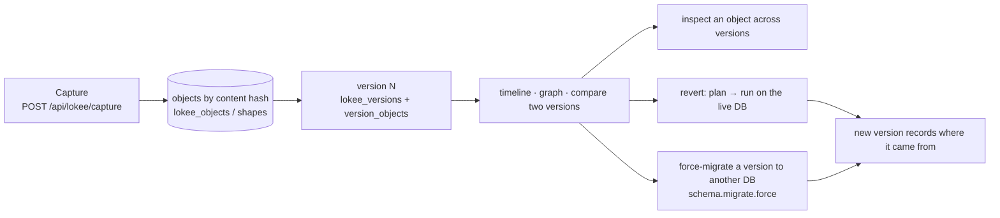

### Workflow engine

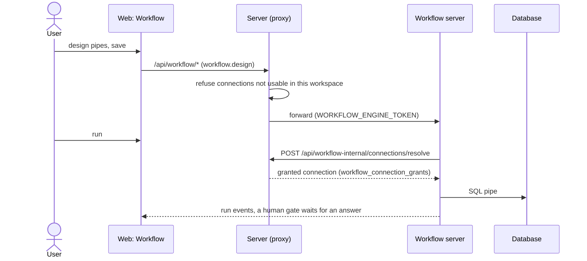

### Access — inspect, build, apply

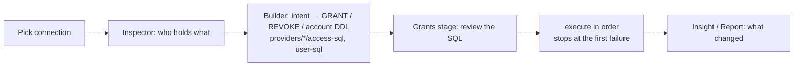

## Metadata schema

The metadata store (`packages/server/src/database/schema.ts`) is SQLite by
default; migrations are append-only. Solid lines are foreign keys; dotted lines
are id columns the code joins on without a declared key (`workspace_id`,
`git_repo_id`, …).

### Identity and workspaces

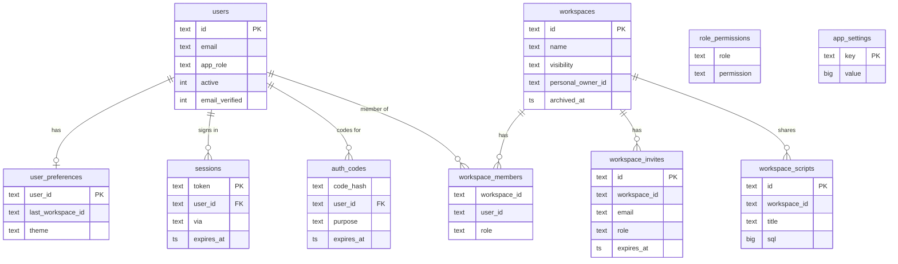

### Connections, secrets, data and workflow

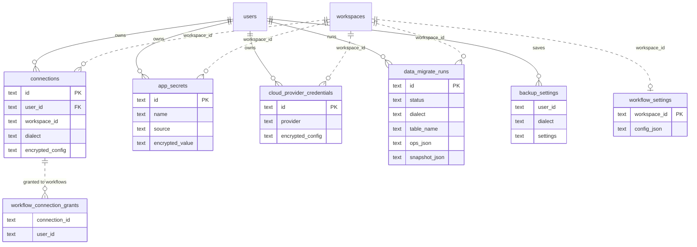

### Migrations, Git and snapshots

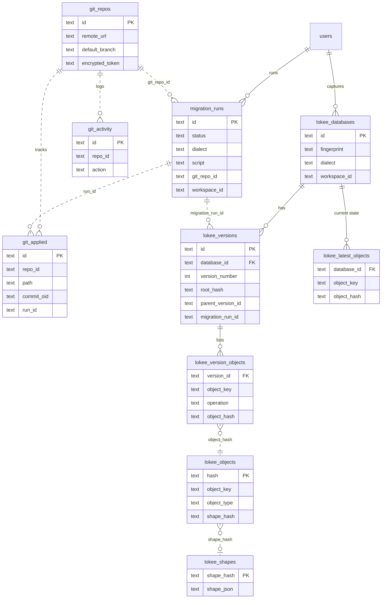

`schema_migrations` records which of the 31 migrations ran.

## Engines and capabilities

From `dialectFeatures()` (`packages/sql/src/modules/capabilities/dialect-features.ts`),
the one table every screen asks. "—" has a reason string the UI shows.

| Engine | Schema compare | DB access | User mgmt | Command mode | Row editing | Transactions | E2E suite |
|---|---|---|---|---|---|---|---|
| PostgreSQL | ✓ | ✓ | ✓ | ✓ | ✓ | ✓ | `dialects/postgres` |
| CockroachDB | ✓ | ✓ | ✓ | ✓ | ✓ | ✓ (DDL auto-commits) | `dialects/cockroachdb` |
| YugabyteDB | ✓ | ✓ | ✓ | ✓ | ✓ | ✓ | `dialects/yugabytedb` |
| MySQL | ✓ | ✓ | ✓ | ✓ | ✓ | ✓ (DDL auto-commits) | `dialects/mysql` |
| MariaDB | ✓ | ✓ | ✓ | ✓ | ✓ | ✓ (DDL auto-commits) | `dialects/mariadb` |
| TiDB | ✓ | ✓ | ✓ | ✓ | ✓ | ✓ (DDL auto-commits) | `dialects/tidb` |
| Db2 | ✓ | ✓ | ✓ | ✓ | ✓ | ✓ | `dialects/db2` |
| SQL Server | ✓ | ✓ | ✓ | ✓ | ✓ | ✓ | `dialects/mssql` |
| Azure SQL | ✓ | ✓ | ✓ | ✓ | ✓ | ✓ | `dialects/azuresql` |
| Oracle | ✓ | ✓ | ✓ | ✓ | ✓ | ✓ (DDL auto-commits) | `dialects/oracle` |
| Redshift | ✓ | ✓ | ✓ | ✓ | ✓ | ✓ | `dialects/redshift` |
| SQLite | ✓ | — | — | ✓ | ✓ | ✓ | `dialects/sqlite` |
| DuckDB | ✓ | — | — | ✓ | ✓ | ✓ | `dialects/duckdb` |
| ClickHouse | ✓ | — | ✓ | ✓ | — | — | `dialects/clickhouse` |
| Redis | — | — | — | — | ✓ (hash keys) | — | — |
| MongoDB | — | — | — | — | ✓ | — | — |

Redis and MongoDB run a fail-closed SQL subset in the editor (single-table
SELECT / INSERT / UPDATE / DELETE with `column = value` predicates).

## Tests and known gaps

| Layer | Where | Count |
|---|---|---|
| Unit — dialect knowledge | `packages/sql` | 86 files (access 13, lokee-weave 15, sql-text 9, migrations 7, utilities 7, sql-editor 7, schema-diff 5, …) |
| Unit — drivers | `packages/db` | 24 (live `*.it.test.ts` behind `FOX_IT_DB=1`) |
| Unit — server | `packages/server` | 100 |
| Unit — web | `apps/web` | 175 (sql-editor 59, lokee-weave 14, access 12, workflow 12, …) |
| Unit — workflow | `packages/workflow-engine`, `apps/workflow-server` | 87 + 19 |
| Unit — CLI | `apps/cli` | 25 |
| E2E (Playwright) | `apps/e2e/src/tests` | 49 specs in 33 groups (`npm run test:e2e:all`) |

Known gaps and open work (2026-10-25) — each belongs on the planning board:

| Feature | Gap | Kind |
|---|---|---|
| `schema.snapshots` | Force-migrate has no e2e: resolving a second credential, the target lock and reading provenance back are unit-tested only | test |
| `schema.snapshots` | Revert scope e2e ("reverts only the ticked object") recorded as failing — re-check | bug? |
| `editor.code` | `code-cell-execute.service.test.ts` timeout test flakes under load (4 s budget includes worker cold start) | test |
| `engines.dialects` | YugabyteDB container stuck on a stale master list (needs a fresh volume) | env |
| `access.inspector` | Oracle `FOX_READER` role not listed: seed account lacks dictionary access | test |
| `editor.run` | Opening a sample bookmark replaces the checked Destinations with none | bug |
| `platform.connections` | Redis: lists, sets, sorted sets, streams and JSON as tables (branch `feat/redis-tables`) | feature |
| `platform.workspaces` | Workspace review fixes: personal-workspace role ceiling, restore archived, Escape (branch `feat/workspace-review`) | bug |
| `platform.admin` | Demo role and demo mode (branch `feat/demo-role`) | feature |
| `editor.peek` | Data peek grid fixes, 2 e2e failing (branch `fix/data-peek-grid`) | bug |
| `editor.datacompare` | Compare 2,000 rows with paging; SQL tracer for owners and admins (plan written) | feature |

## Planning work

The planning board (a shared page) holds one row per work item. A work item is:

| Field | Values |
|---|---|
| Feature | an ID from this page (`editor.peek`, …), optionally a sub-feature |
| Kind | bug · improvement · test · new sub-feature · manual test |
| Title, detail | what and why; the failure for a bug |
| Status | backlog → scheduled → in progress → in review → done (or blocked) |
| Priority | P0 (data loss / security) · P1 · P2 · P3 |
| Owner, target | who, and the date or sprint |
| Links | PR, branch, issue, plan |
| Manual test | last run date, result (pass / fail / partial), notes |

Every feature and every engine (`dialect.postgres` … `dialect.mongodb`) has a
test-and-fix pass on the board, in the waves the
[test and fix plan](plans/2026-10-25-feature-and-dialect-test-plan.md) sets.

Before starting an item, read its row in the [Feature catalog](#feature-catalog):
the **Tests** column names the specs that must still pass, the **Perms** column
the guard a change must keep, the **Tables** column the migrations it may need
(append-only). A manual-test pass for a feature walks its sub-features in the
order listed.

## Keeping this page true

Re-measure after a feature lands or moves:

```bash
# routes per area (the contract test pins every route)
grep -oE "path: '/api/[a-z-]+" packages/server/src/api/http-contract.test.ts | sort | uniq -c
# server feature modules
ls packages/server/src/features
# frontend features
ls apps/web/src/frontend/features
# metadata tables
grep -oE "CREATE TABLE IF NOT EXISTS [a-z_]+" packages/server/src/database/schema.ts
# e2e specs
find apps/e2e/src/tests -name '*.test.ts' | wc -l
```

A new feature adds a catalog row, a tree node and, if it stores anything, its
tables in the schema diagram.
